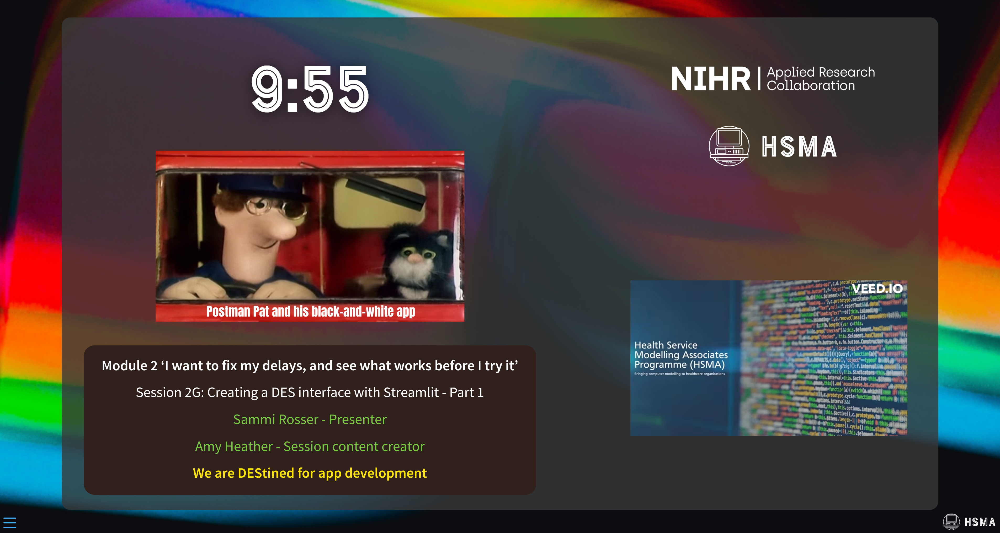
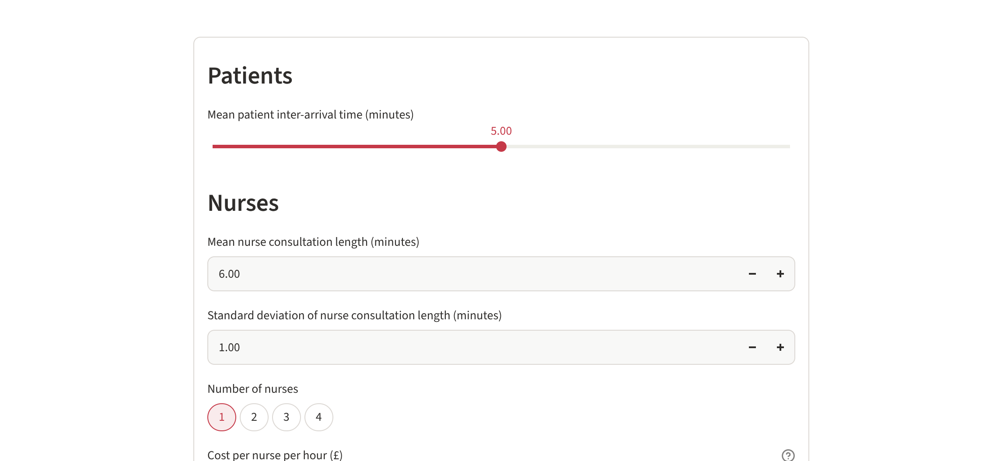
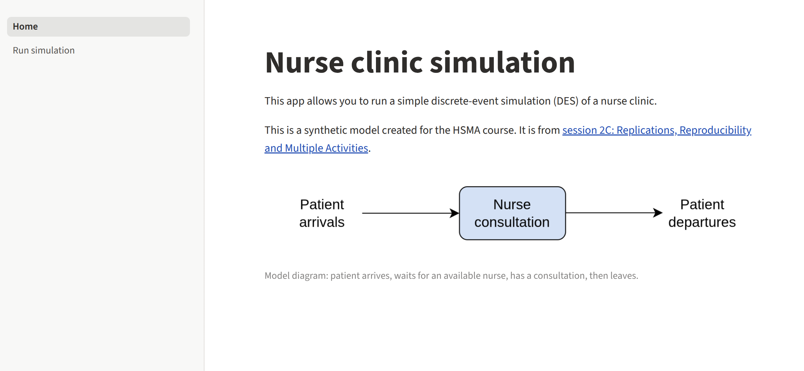

## Slides

:::: {.resource-card}

::: {.resource-actions}
[Open slides](slides/slides.qmd){.btn .btn-info}
:::

{fig-alt="Preview of the slides"}

::::

## Single-page app

:::: {.resource-card}

::: {.resource-actions}
[Run in browser](app/singlepage/index.html){.btn .btn-info}
[Open cloud app](https://hsma-des-simple.streamlit.app/){.btn .btn-primary}
:::

{fig-alt="Preview of the single-page app"}

::::

## Multipage app

:::: {.resource-card}

::: {.resource-actions}
[Run in browser](app/multipage/index.html){.btn .btn-info}
[Open cloud app](https://hsma-des-multipage.streamlit.app/){.btn .btn-primary}
:::

{fig-alt="Preview of the multipage app"}

::::