##

<audio
  controls
  data-autoplay
  preload="auto"
  src="https://github.com/hsma-programme/hsma_assets/raw/refs/heads/main/h6_theme.mp3">
</audio>

:::: {.columns}

::: {.column width="55%"}

<div class="hsma-countdown"></div>

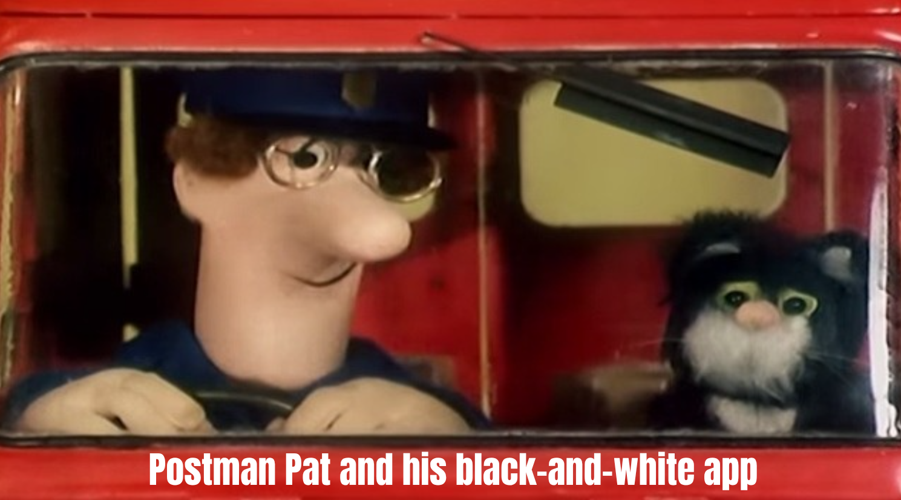{height=250px}

::: {style="font-size: 21px; background-color: #31211d; border-radius: 16px; padding: 5px 0px;"}

**Module 2 'I want to fix my delays, and see what works before I try it'**

Session 2G: Creating a DES interface with Streamlit - Part 1

[Sammi Rosser - Presenter]{style="color: #7ac943;"}

[Amy Heather - Session content creator]{style="color: #7ac943;"}

[**We are DEStined for app development**]{style="color: #ffe600;"}

:::

:::

::: {.column width="10%"}

:::

::: {.column width="35%"}

{width=300px}

{width=200px}

<br><br><br>

<iframe
  data-src="https://www.youtube.com/embed/AExH1e6SvZA?autoplay=1&mute=1&controls=0&loop=1&playlist=AExH1e6SvZA&enablejsapi=1"
  data-autoplay
  style="display: block; width: 100%; aspect-ratio: 16 / 9; border: 0;"
  allow="autoplay; encrypted-media; fullscreen"
  allowfullscreen>
</iframe>

:::

::::


## You've built a DES model!

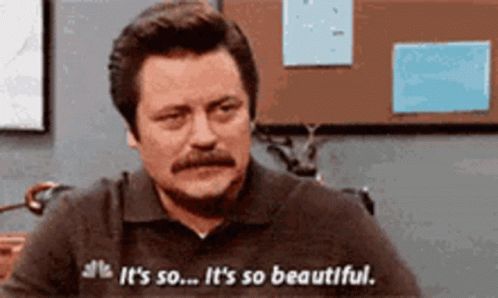{height=400px}

Now it's time to share results of the model.


## Let's share the model

:::: {.columns}

::: {.column width="50%"}


:::

::: {.column width="50%"}


You could send everyone your Python code.<br/>
But they might not...

* Know Python.
* Have it installed.
* Have the right environment or packages.
* Know which bits to run or which numbers to change.
* Have time to figure all that out.

:::

::::


## Actually, let's send a report

:::: {.columns}

::: {.column width="50%"}

Run a few scenarios.

Make some lovely charts.

Send everyone a report.

Job done. Surely.

:::

::: {.column width="50%"}


:::

::::


## You get a few questions back...

:::: {.columns}

::: {.column width="50%"}

"Can you rerun it with another three beds?"

"What if we have fewer staff on Tuesdays?"

"Can we change the arrival rate?"

"Can you try all three of those things together?"

<br>

Somewhere, a file called `final_report_v7_ACTUAL_FINAL.pdf` is being created.

<br>

But what if they could try it themselves?

:::

::: {.column width="50%"}


:::

::::


##

{height=500px}


## Enter Streamlit

Streamlit lets us build a data-focused web application in Python.

We can give our DES model an interface so people can:

* Choose model inputs
* Run scenarios
* Explore charts and results


## DES app showcase: acute medical unit {.showcase}

<https://amumodelling-hsma.streamlit.app/>

::: {.r-stack}

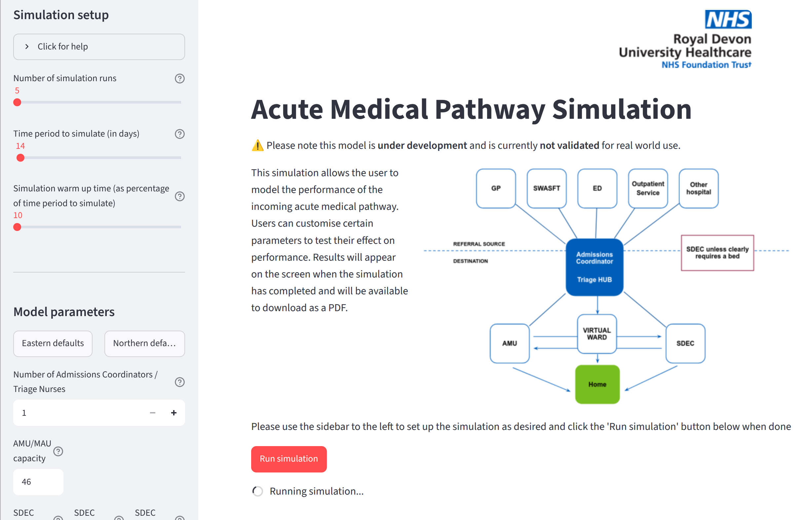{height=570px}

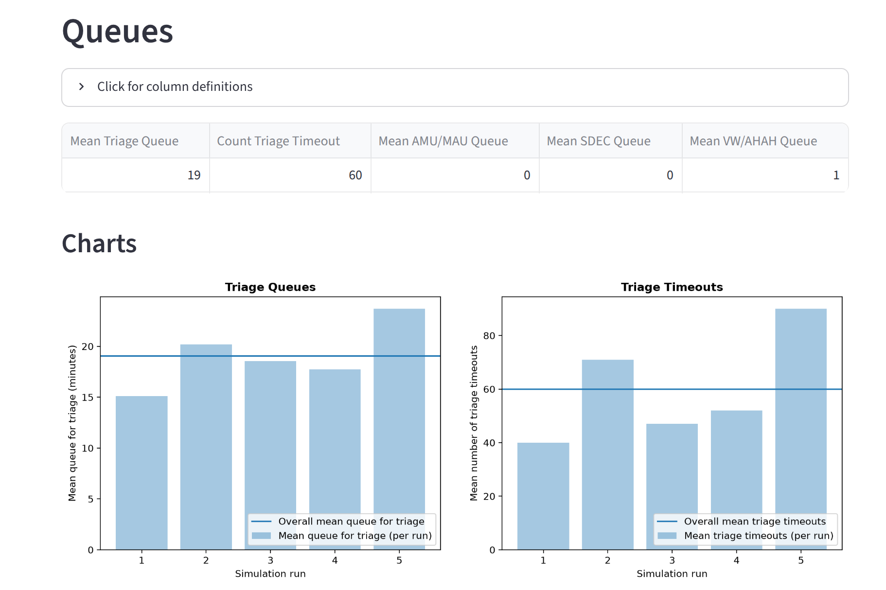{.fragment height=570px}

:::


## DES app showcase: elective surgery{.showcase visibility="hidden"}

TODO: Not currently working

<https://gstt-hands-waitlist.streamlit.app/>


## DES app showcase: stroke ward {.showcase}

<https://stroke-model-des.streamlit.app/>

::: {.r-stack}

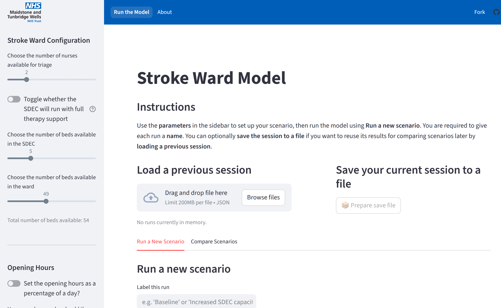{height=570px}

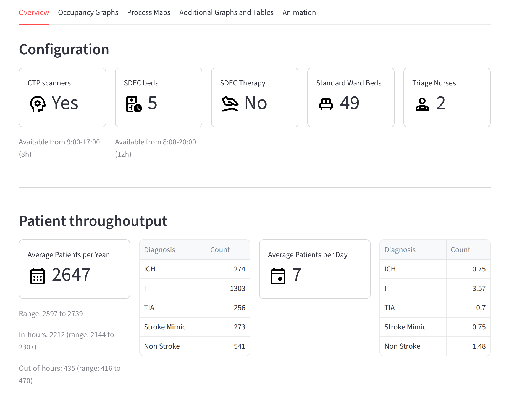{.fragment height=570px}

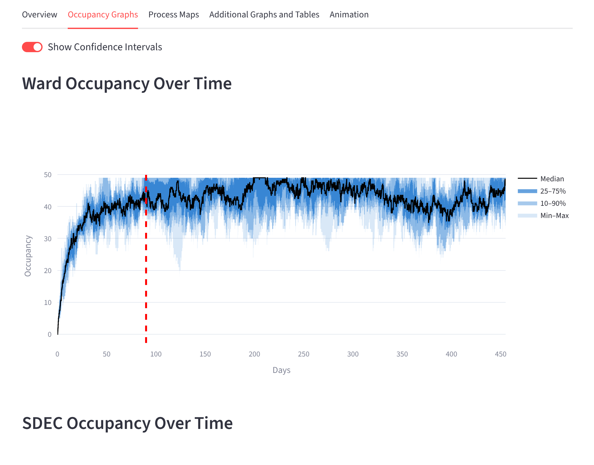{.fragment height=570px}

:::


## DES app showcase: non-elective flow {.showcase}

<https://non-elective-flow-simulation-model-club.streamlit.app/>

::: {.r-stack}

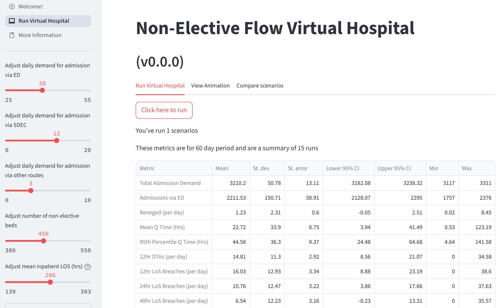{height=570px}

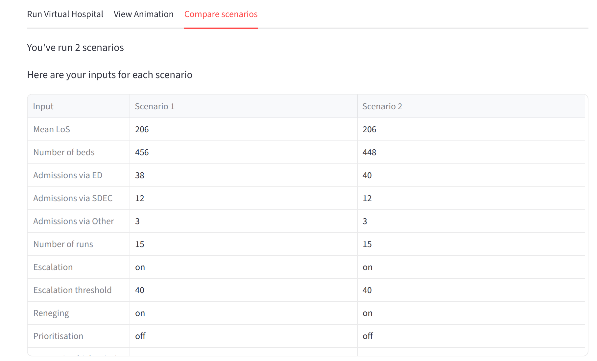{.fragment height=570px}

:::


## DES app showcase: urgent treatment centre {.showcase}

<https://stars-simpy-example.streamlit.app/>

::: {.r-stack}

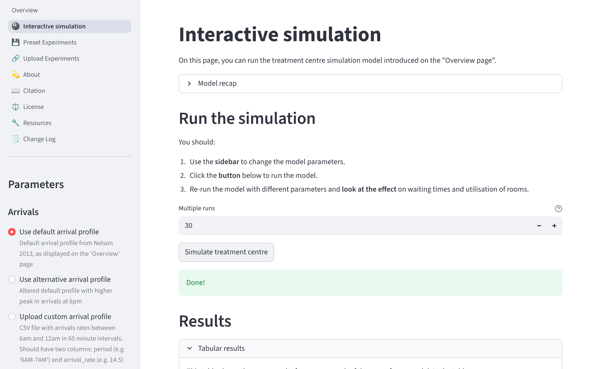{height=570px}

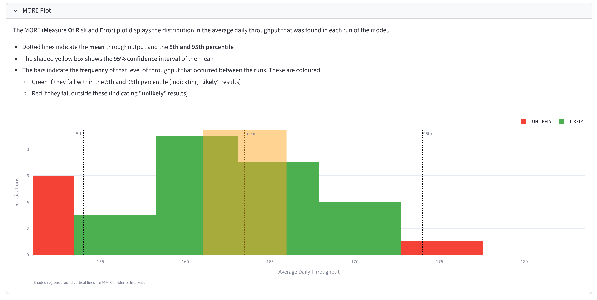{.fragment height=570px}

:::


## DES app showcase: DES playground {.showcase}

<https://playground.hsma.co.uk/>

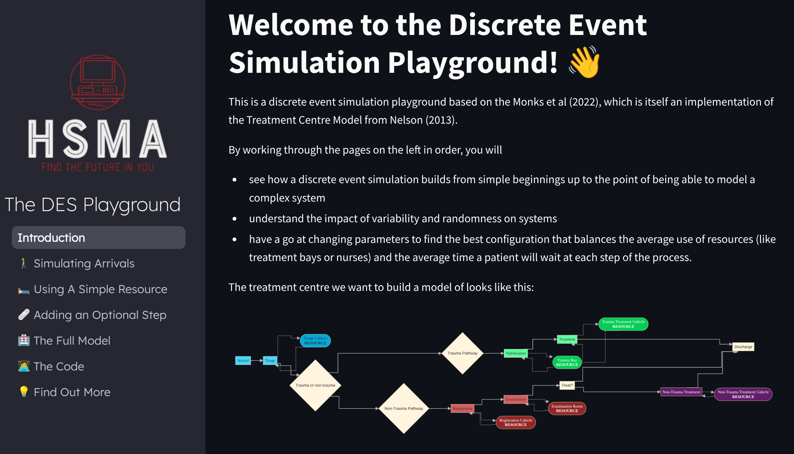{height=570px}


## DES app showcase: vidigi examples {.showcase visibility="hidden"}

TODO

<https://simpy-visualisation.streamlit.app/>


# Getting started with streamlit


## How to create and run a Streamlit app

1. Install Streamlit.

   ```bash
   pip install streamlit
   ```

<div style="height: 10px;"></div>

2. Create a Python script (e.g., `app.py`).

<div style="height: 10px;"></div>

3. Import Streamlit at the top of your script:

   ```python
   import streamlit as st
   ```

<div style="height: 10px;"></div>

4. Run your app from the terminal:

   ```bash
   streamlit run app.py
   ```


## What can we put in a Streamlit app?

Let's start with text: a title, a header and a subheader.

:::: {.columns}

::: {.column width="50%"}

`app.py`:

```{.python}

```

:::

::: {.column width="50%"}

App:

```{stlite-python}

```

:::

::::


## Other Streamlit text

Dedicated commands for different text styles, or `st.write()` for general-purpose output.

:::: {.columns}

::: {.column width="50%"}

```{.python}

```

:::

::: {.column width="50%"}

```{stlite-python}

```

:::

::::


## Widgets: `st.radio`

Widgets are interactive controls that let users provide input.

For example, `st.radio` lets users choose one option from a list.

Set the prompt with `label`, the choices with `options`, and the starting position with `index` (`0` selects the first option).

:::: {.columns}

::: {.column width="50%"}

```{.python}

```

:::

::: {.column width="50%"}

```{stlite-python}

```

:::

::::


## Widgets: `st.pills` and `st.segmented_control`

These display the choices as buttons rather than a radio list.

Use `label` and `options` as before, but set the starting choice with `default` (e.g., `"A"`) rather than its position.

:::: {.columns}

::: {.column width="50%"}

```{.python}

```

:::

::: {.column width="50%"}

```{stlite-python}

```

:::

::::


## Widgets: `st.slider` and `st.numeric_input`

Drag a slider or type a number to set a numeric value.

Set the prompt with `label`, the limits with `min_value` and `max_value`, the starting value with `value`, and the increment with `step`.

:::: {.columns}

::: {.column width="50%"}

```{.python}

```

:::

::: {.column width="50%"}

```{stlite-python}

```

:::

::::


## Accessing the chosen value

Access the chosen value through a variable or `st.session_state`.

<br>

To assign the widget's return value to a variable:

:::: {.columns}

::: {.column width="60%"}

```{.python code-line-numbers="3,11"}

```

:::

::: {.column width="40%"}

```{stlite-python}

```

:::

::::


## Accessing the chosen value

Alternatively, give the widget a `key` to access its value through `st.session_state`.

:::: {.columns}

::: {.column width="60%"}

```{.python code-line-numbers="9,12"}

```

:::

::: {.column width="40%"}

```{stlite-python}

```

:::

::::


## Session state

:::: {.columns}

::: {.column width="50%"}

Session state keeps track of values between script re-runs, like a dictionary for the current user's session.

<br>

For our slider with a `key`:

1. The user chooses a new inter-arrival time.

2. Streamlit updates the value in `st.session_state`.

3. The script reruns, reading and using the updated value.

:::

::: {.column width="50%"}


:::

::::


# Let's build a streamlit app for our DES model


## Let's build a streamlit app!

We'll use the DES model from session 2C. As a reminder:

* It has `Param`, `Patient`, `Model`, and `Trial` classes.
* It simulates a simple nurse clinic.

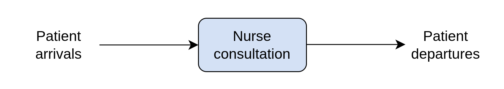


## Before we build the app...

This app will help decision-makers explore staffing options, considering both patient waiting times and staffing costs.

Let’s add an hourly cost per nurse.

```{.python code-line-numbers="10,18"}
class Param:
    def __init__(
        self,
        mean_patient_inter=5,
        mean_nurse_consult_time=6,
        sd_nurse_consult_time=1,
        num_nurses=1,
        sim_duration=120,
        num_replications=5,
        nurse_cost_per_hour=30,
    ):
        self.mean_patient_inter = mean_patient_inter
        self.mean_nurse_consult_time = mean_nurse_consult_time
        self.sd_nurse_consult_time = sd_nurse_consult_time
        self.num_nurses = num_nurses
        self.sim_duration = sim_duration
        self.num_replications = num_replications
        self.nurse_cost_per_hour = nurse_cost_per_hour
```


## Before we build the app...

Calculate the total staffing cost from the number of nurses, the simulation duration and the hourly rate.

This lets us compare the cost of each staffing option alongside its effect on waiting times.

```{.python code-line-numbers="9-14"}
        self.ci_lower_q_time_nurse = self.trial_mean_q_time_nurse - (
            t * self.se_q_time_nurse
        )

        self.ci_upper_q_time_nurse = self.trial_mean_q_time_nurse + (
            t * self.se_q_time_nurse
        )

        self.total_nurse_cost = (
            self.param.num_nurses
            * self.param.sim_duration
            / 60
            * self.param.nurse_cost_per_hour
        )
```


## Updated model with nurse costs

```{.python code-overflow="scroll" code-line-numbers="32,40,149-155"}

```


## Streamlit app

We'll build a simple app in four steps:

1. Create the app **script**.

2. Get **inputs** from the user.

3. **Run** the model using those inputs.

4. **Display** the results.


## Create the app script

:::: {.columns}

::: {.column width="50%"}

Create `app.py` in the same folder as `model.py`.

It should contain these imports:

```{.python}
import plotly.express as px
import streamlit as st

from model import Param, Trial
```

* `plotly.express`: chart the results.
* `streamlit`: build the interface.
* `Param` and `Trial`: configure and run the model. Here, `model` refers to `model.py` in the same folder. The import makes `Param` and `Trial` available in our app.

:::

::: {.column width="10%"}

:::

::: {.column width="40%"}

::: {.fragment}

> **Why two Python files?**
>
> * Run and test the model independently of the app.
> * Avoid redefining model classes each time Streamlit reruns.

:::

:::

::::


## Get inputs from the user

**Which model parameters should users be able to change?**  
For this app, we'll include all everything in `Param`.


:::: {.columns}

::: {.column width="50%"}

```{.python}

```

:::

::: {.column width="50%"}

* Mean time between arrivals
* Mean and SD of consultation time
* Number of nurses
* Simulation duration
* Number of replications
* Hourly cost per nurse

:::

::::


## Inputs: inter-arrival time

We'll use our original default (`5`), then choose some suitable limits and a step size.


:::: {.columns}

::: {.column width="55%"}

```{.python}

```

:::

::: {.column width="45%"}

```{stlite-python}
import streamlit as st


```

:::

::::


## Inputs: Consultation time

:::: {.columns}

::: {.column width="55%"}

```{.python}

```

:::

::: {.column width="45%"}

```{stlite-python}
import streamlit as st


```

:::

::::


## Inputs: Number of nurses

:::: {.columns}

::: {.column width="55%"}

```{.python}

```

:::

::: {.column width="45%"}

```{stlite-python}
import streamlit as st


```

:::

::::


## Inputs: Hourly cost

All widgets have a `help` parameter.

We can use it here to explain what the hourly cost should include.

<br>

:::: {.columns}

::: {.column width="55%"}

```{.python}

```

:::

::: {.column width="45%"}

```{stlite-python}
import streamlit as st


```

:::

::::


## Inputs: Simulation

:::: {.columns}

::: {.column width="55%"}

```{.python}

```

:::

::: {.column width="45%"}

```{stlite-python}
import streamlit as st


```

:::

::::


## Complete set of user inputs for the app

:::: {.columns}

::: {.column width="55%"}

```{.python}

```

:::

::: {.column width="45%"}

::: {style="height: 550px;"}

```{stlite-python}
import streamlit as st


```

:::

:::

::::


## Run model using the inputs

Now we want to run the model in our app, using the selected values instead of relying on the model's defaults.

```{.python}

```


## When should the model run?

Changing an input reruns the script, but we only want to run the simulation when the user is ready.

`st.button()` adds a button. Clicking it re-runs the script and returns `True` for that run, so the indented simulation code executes.

```{.python code-line-numbers="1"}

```


## Displaying simulation results

Previously we printed results to the terminal. We can display similar text in our app.

```{.python code-line-numbers="15-37"}

```


## Charts

Various plotting libraries are supported. For example, using plotly, you create a figure then use `st.plotly_chart()` to display it in the app.

```{.python code-line-numbers="39-50"}

```


## Dataframes

We can create interactive tables with `st.dataframe()` or static tables with `st.table()`.

```{.python code-line-numbers="52-62"}

```


## Our app

```{stlite-python}
# stlite requires micropip and installation without dotted module names
import micropip
await micropip.install("plotly")
await micropip.install("sim-tools")
await micropip.install("simpy")

import streamlit as st
from plotly import express as px




```


## Improving layout: `st.container`

:::: {.columns}

::: {.column width="40%"}

We can group elements using `st.container()`.

Let's add a border around our model parameters using `with st.container(border=True):`.

Indent the code for the elements you want inside the container.

:::

::: {.column width="60%"}

```{.python code-line-numbers="1"}

```

:::

::::


## Improving layout: `st.expander`

:::: {.columns}

::: {.column width="30%"}

`st.expander()` can be used to hide optional data.

Let's hide the dataframe with results from individual replications.

:::

::: {.column width="70%"}

```{.python code-line-numbers="52"}

```

:::

::::


## Improving layout: `st.space`

:::: {.columns}

::: {.column width="30%"}

Use `st.space()` to add space between sections of the app.

Set `size` to adjust the spacing. The default is `"small"`.

:::

::: {.column width="70%"}

```{.python code-line-numbers="47,91,105"}

```

:::

::::


## Our app (with new container, expander and spacing)

```{stlite-python}
# stlite requires micropip and installation without dotted module names
import micropip
await micropip.install("plotly")
await micropip.install("sim-tools")
await micropip.install("simpy")

import streamlit as st
from plotly import express as px



```


## Exercise

Now it's your turn to build a Streamlit app! You have been provided two scripts:

* `model.py` - the simulation model. You shouldn't need to change this.
* `analysis.py` - code to run the model and analyse the results. Adapt this code for your app.

<br>

Create an `app.py` script and work through these steps:

1. Add input widgets so users can choose the model parameters.
2. Add a button to run the model with their chosen inputs.
3. Display the analysis and results.


# Multipage apps

## Multipage apps

:::: {.columns}

::: {.column width="50%"}

<br>

So far, we have created a single page app.

<br>

Now let's turn it into a multipage app by adding a homepage. This should:

* Introduce the model and its uses.
* Explain how to use the app.
* Credit the authors.

:::

::: {.column width="50%"}


:::

::::


## Organising our multipage app

1. Rename our existing `app.py` to `simulation.py`.
2. Create `home.py` for our homepage.
3. Create `app.py` as the main entry point. In `app.py`, we define each page using `st.Page()` and provide these as a list to `st.navigation()` which we then `run()`.

`app.py`:

```{.python}

```


## `home.py`

```{.python}

```


## Our app

TODO


# Deploying your app on Streamlit Community Cloud

## Streamlit Community Cloud

TODO: Explain what it is


## Deploying on Community Cloud

1. Sign in with GitHub at <https://streamlit.io/cloud>.

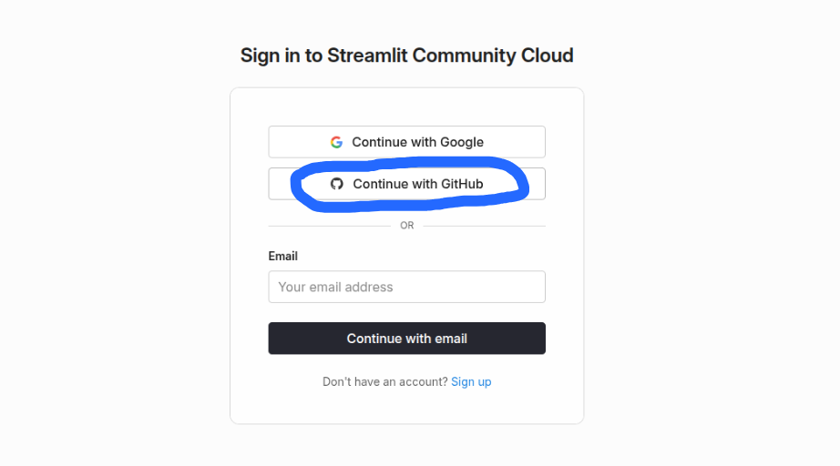{height=400px}


## Deploying on Community Cloud

2. In top right corner, click "Create app" then choose "Deploy a public app from GitHub".

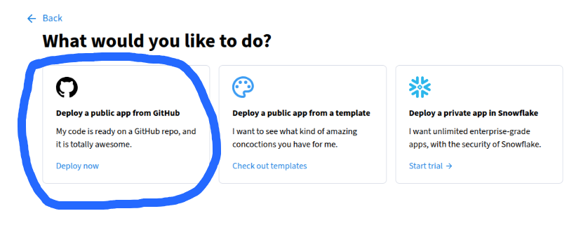


## Deploying on Community Cloud

3. Enter details for the app you want to deploy.

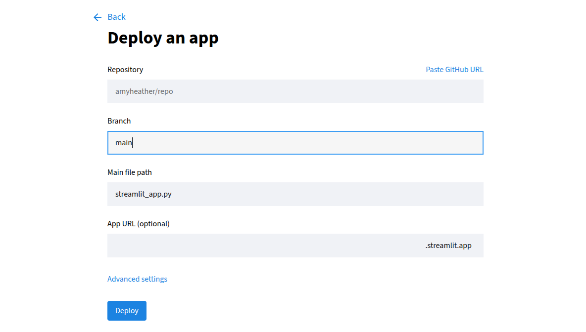{height=450px}


## Deploying on Community Cloud

TODO


## Exercise

**Task 1:** Add a homepage to the app you created in the last exercise.

**Task 2:** Deploy your app on Streamlit Community Cloud.


## DAY TWO MORNING : SECTION 4 SCENARIOS

now going to show how to make an app that can compare scenarios

need to be able to save results of a run

and then compare between them

to do this, we're going to split the simulation page into two

one that runs scenarios

one that can look at results of a scenario or compare them


## split

show splitting the two


## run and save scenarios

save how? session state

can do a success message, it saved yay


## show scenarios

help user keep track
show scenarios table


## results

results

single scenario or compare

st.tabs


## single scenario results

its same results code as before
just need to choose from scenarios
let user choose
can use a dropdown


## single scenario results

can remind of scenarios again with dataframe
can use pd.styler to highlight which they chose


## compare scenarios

need to run at least two
do message for that


## choose which to compare

choose which scenarios to compare
can use multiselect


## show chosen

can do the table again with pd.styler


## comparison figure

good for comparison is often boxplot
here also showing individual rep on boxplot


## comparison table

could also compare those summary stats in a table
and the staffing costs


## exercise

change app from yesterday from singlepage to multipage
with scenario comparison


## DAY TWO MORNING/AFTERNOON : SECTION 5 HOSTING WITH ST LITE

st lite


## exercise

host your app with stlite


## DAY TWO AFTERNOON : SECTION 6 CUSTOMISING APP APPEARANCE

theme

css

logo

etc.

st.set_page_config

st.logo


## exercise

customise appearance of your app
